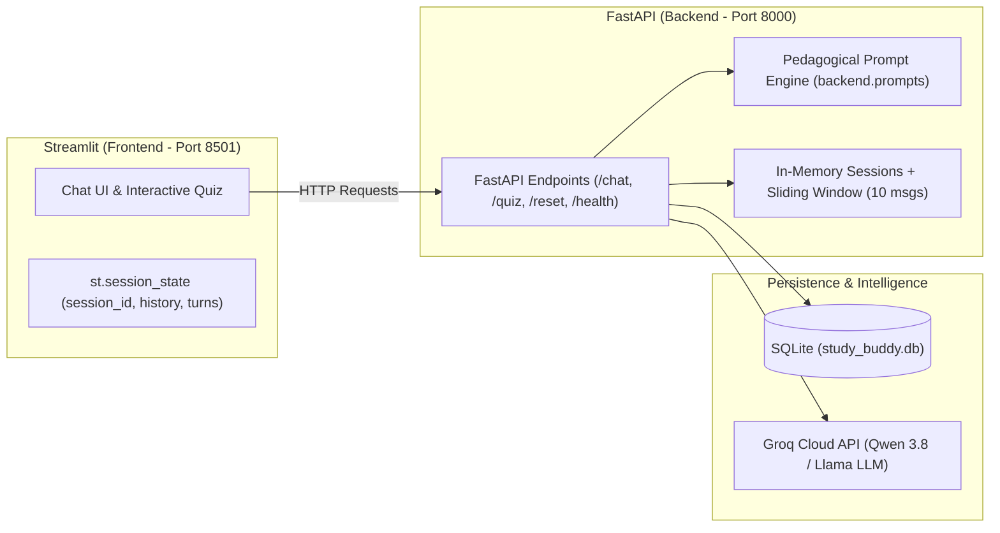

# Assignment 1: Study Buddy (Streamlit + FastAPI)

An AI-powered, step-by-step interactive tutor application built with **FastAPI**, **Streamlit**, and the **Groq LLM API**. Study Buddy is designed to guide students through concepts and homework problems pedagogically—never handing over direct solutions, but breaking problems down step by step and asking guiding questions.

---

## 🏗️ Architecture Overview

The project is structured with a decoupled client-server architecture:

```
study-buddy/
├── backend/
│   ├── __init__.py
│   ├── database.py      # SQLite database persistence layer (Bonus)
│   ├── main.py          # FastAPI application & API endpoints
│   └── prompts.py       # Subject-tailored system prompts with strict pedagogical rules
├── app.py               # Streamlit interactive frontend application
├── requirements.txt     # Python dependencies
├── .env.example         # Template for environment variables
├── .gitignore           # Ignores .venv, .env, *.db, and cache files
└── study_buddy.db       # Local SQLite database (ignored by git)
```



---

## ✨ Features & Requirements

### 1. Core Assignment Requirements
- **Requirement 1 (Step-by-Step Guidance):** The tutor guides the student through problems one step at a time rather than giving away direct answers.
- **Requirement 2 (Multi-turn Memory):** Remembers conversational context across turns using an in-memory session dictionary, slicing only the last 10 messages to maintain clean context windows.
- **Requirement 3 (Subject Specialization):** Provides specialized system prompts for 4 distinct subjects:
  - 📐 **Math**
  - 🔬 **Science**
  - 📖 **English**
  - 💻 **Computer Science**
  - *Strict Rules:* Every prompt enforces step-by-step breakdown, asking exactly one follow-up question per turn, and never giving direct answers upfront.
- **Requirement 4 (Session Reset):** A "New Conversation" button resets both backend memory and frontend state with a new unique session ID.
- **Requirement 5 (Health Check):** `GET /health` endpoint verifies backend availability.
- **Requirement 6 (Streamlit Frontend):** Built with `st.chat_message`, `st.chat_input`, and an organized `st.sidebar` featuring subject selection and session metrics.
- **Requirement 7 (Error Handling):** Graceful recovery from API timeouts, disconnection, and token limits with user-friendly error notifications.

### 2. Bonus Features
- 💾 **SQLite Chat Persistence (`backend/database.py`):**
  - Automatically records chat history to a local SQLite database (`study_buddy.db`).
  - Automatically hydrates in-memory sessions on startup or when accessed, ensuring chat histories survive server restarts.
- 📝 **Interactive 3-MCQ Practice Quiz:**
  - `POST /quiz` generates 3 subject-relevant multiple-choice questions in strict JSON format.
  - Interactive radio selections in Streamlit with dynamic button validation (the "Check Answer" button remains greyed out until all 3 questions are answered).
  - Instant score calculation with visual feedback (`st.success` / `st.error`) and detailed tutor explanations for each question.

---

## 🚀 Setup & Installation

### 1. Prerequisites
- Python 3.10+ installed
- A free [Groq Cloud API Key](https://console.groq.com/keys)

### 2. Clone and Setup Environment

```bash
# Clone the repository
git clone https://github.com/your-username/study-buddy.git
cd study-buddy

# Create a virtual environment
python -m venv .venv

# Activate the virtual environment
# Windows (PowerShell):
.venv\Scripts\Activate.ps1
# macOS / Linux:
source .venv/bin/activate

# Install dependencies
pip install -r requirements.txt
```

### 3. Environment Variables
Copy `.env.example` to create your `.env` file:
```bash
cp .env.example .env
```
Open `.env` and fill in your Groq API key:
```env
BACKEND_URL=http://localhost:8000
LLM_API_KEY=your_groq_api_key_here
LLM_BASE_URL=https://api.groq.com/openai/v1
LLM_MODEL=qwen/qwen3.8-27b
```

---

## 💻 Running the Application

For the best experience, run the backend and frontend in two separate terminal windows.

### Terminal 1: FastAPI Backend
```bash
# Ensure .venv is activated
uvicorn backend.main:app --port 8000 --reload
```
The backend API documentation will be available at:
- **API Documentation (Swagger UI):** [http://localhost:8000/docs](http://localhost:8000/docs)
- **Health Check:** [http://localhost:8000/health](http://localhost:8000/health)

### Terminal 2: Streamlit Frontend
```bash
# Ensure .venv is activated
streamlit run app.py
```
Streamlit will automatically open your browser at [http://localhost:8501](http://localhost:8501).

---

## 🧪 Testing the API

You can test the backend directly using `curl` or Python:

```bash
# Test /health
curl -X GET http://localhost:8000/health

# Test /chat
curl -X POST http://localhost:8000/chat \
  -H "Content-Type: application/json" \
  -d '{"session_id": "test_1", "subject": "math", "message": "How do I solve 2x+5=11?"}'
```

---

## 📜 License
This project is open-source and created for educational purposes.
